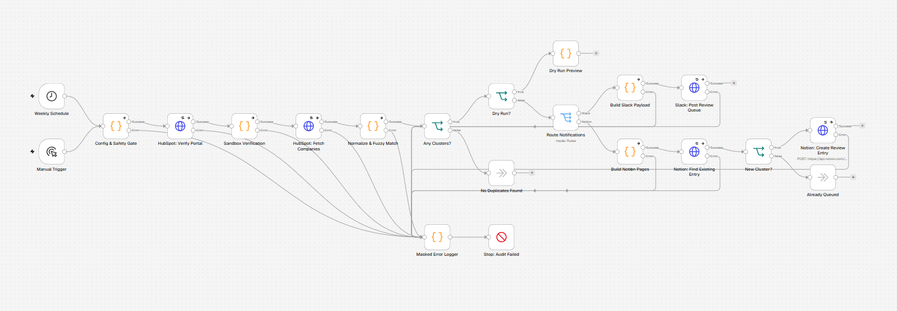

# n8n-hubspot-duplicate-company-domain-fuzzy-matcher

A scheduled, **read-only** audit that finds subtle duplicate companies in HubSpot. It catches legal-suffix variants (`Acme Corp` / `ACME, Inc.`), sub-domain and URL variants (`eu.acme.example` / `https://www.acme.example/about`) and typos (`Globex Industries` / `Globex Industires Ltd`). It scores candidates with Jaro-Winkler and Levenshtein similarity and delivers **one consolidated, deduplicated review queue** to Slack and/or Notion.

The repository ships two equivalent runtimes:

| Runtime | Use it for |
|---|---|
| `workflows/n8n-hubspot-duplicate-company-domain-fuzzy-matcher.json` | Weekly scheduled runs inside n8n |
| `src/` Node.js CLI | Local runs, CI pipelines, plain cron hosts, offline testing |

Both run **the same code**. The n8n Code nodes are generated from `src/safety.js`, `src/matcher.js` and `src/formatters.js`, and the test suite executes those nodes and checks that they return exactly what the CLI returns.

Zero runtime dependencies. Zero test dependencies. Node.js 18 or later.

---

## Contents

- [Safety model](#safety-model)
- [Architecture](#architecture)
- [How the fuzzy matching works](#how-the-fuzzy-matching-works)
- [Configuration](#configuration)
- [HubSpot setup](#hubspot-setup)
- [n8n setup](#n8n-setup)
- [Node.js CLI](#nodejs-cli)
- [Slack setup](#slack-setup)
- [Notion setup](#notion-setup)
- [Testing](#testing)
- [Repository layout](#repository-layout)
- [Limitations and tuning](#limitations-and-tuning)

---

## Safety model

| Guardrail | Behaviour |
|---|---|
| **Read-only HubSpot access** | Only `GET` requests are made to HubSpot: account details and companies. Nothing in HubSpot is merged, edited or deleted. |
| **`DRY_RUN=true` by default** | The full audit runs, but nothing is sent to Slack or Notion. n8n shows a *Dry Run Preview* item; the CLI prints a summary and can write a full report. Only the exact value `false` (or `0`, `no`, `off`) turns it off. A typo such as `flase` keeps it on. |
| **`SANDBOX_MODE=true` by default** | Before any company data is read, `GET /account-info/v3/details` must report `accountType` `SANDBOX` or `DEVELOPER_TEST`. Any other portal stops the run. Set `SANDBOX_MODE=false` deliberately when you move to production. |
| **Secrets only from the environment** | `HUBSPOT_ACCESS_TOKEN`, `SLACK_WEBHOOK_URL`, `NOTION_API_KEY` and `NOTION_DATABASE_ID` are read from `$env` in n8n and `process.env` in Node. They are never placed in n8n item data, reports or logs. |
| **Masked logging** | Errors go through `maskError()`, which removes known secret values, bearer tokens, HubSpot `pat-` tokens, Slack webhook URLs, Notion keys and IDs, and email addresses. |
| **No CLI flag can disable a gate** | `--dry-run` can only make a run safer. Turning gates off is always an explicit environment change. |
| **Offline mode is always a dry run** | `--input file.json` never touches the network. |
| **Review-queue idempotency** | Each cluster has a stable `clusterId`. Notion entries are created only if that ID is not already in the database, so weekly runs do not pile up duplicate review items. |

---

## Architecture



```
 ┌───────────────────┐   ┌────────────────┐
 │ Schedule Trigger  │   │ Manual Trigger │
 │ (Mon 07:00 weekly)│   └───────┬────────┘
 └─────────┬─────────┘           │
           └──────────┬──────────┘
                      ▼
        ┌──────────────────────────┐   reads $env, validates config,
        │   Config & Safety Gate   │   DRY_RUN / SANDBOX_MODE default true,
        └────────────┬─────────────┘   emits settings WITHOUT secrets
                     ▼
        ┌──────────────────────────┐
        │  HubSpot: Verify Portal  │   GET /account-info/v3/details
        └────────────┬─────────────┘
                     ▼
        ┌──────────────────────────┐   accountType must be SANDBOX or
        │   Sandbox Verification   │   DEVELOPER_TEST unless SANDBOX_MODE=false
        └────────────┬─────────────┘
                     ▼
        ┌──────────────────────────┐   GET /crm/v3/objects/companies
        │ HubSpot: Fetch Companies │   100/page, cursor pagination (paging.next.after)
        └────────────┬─────────────┘
                     ▼
        ┌──────────────────────────┐   domain root extraction · legal-suffix stripping
        │  Normalize & Fuzzy Match │   blocking · Jaro-Winkler + Levenshtein scoring
        └────────────┬─────────────┘   union-find clustering → review queue
                     ▼
              ┌─────────────┐  no   ┌──────────────────────┐
              │Any Clusters?├──────►│ No Duplicates Found  │
              └──────┬──────┘       └──────────────────────┘
                     │ yes
                     ▼
              ┌─────────────┐  yes  ┌──────────────────────┐
              │  Dry Run?   ├──────►│   Dry Run Preview    │  Slack + Notion payloads
              └──────┬──────┘       └──────────────────────┘  + CSV, nothing sent
                     │ no
                     ▼
        ┌──────────────────────────┐
        │   Route Notifications    │  (Switch, all matching outputs)
        └──────┬────────────┬──────┘
         Slack │            │ Notion
               ▼            ▼
   ┌────────────────┐  ┌────────────────────┐   ┌──────────────┐   ┌────────────────────┐
   │Build Slack     │  │Build Notion Pages  ├──►│Notion: Find  ├──►│New Cluster?        │
   │Payload         │  │(1 item per cluster)│   │Existing Entry│   │ yes → Create Entry │
   └───────┬────────┘  └────────────────────┘   └──────────────┘   │ no  → Already Queued│
           ▼                                                       └────────────────────┘
   ┌────────────────┐
   │Slack: Post     │  Block Kit summary + CSV breakdown
   │Review Queue    │
   └────────────────┘

  Every HTTP and Code node routes failures to:
        ┌──────────────────────┐     ┌────────────────────┐
        │ Masked Error Logger  ├────►│ Stop: Audit Failed │   (execution marked failed,
        └──────────────────────┘     └────────────────────┘    message already masked)
```

The CLI (`src/index.js`) follows the same sequence: `config.js` → `hubspot.js` (verify portal, sandbox gate, paginated fetch) → `matcher.js` → `formatters.js` → `notifiers.js`.

---

## How the fuzzy matching works

### 1. Domain root extraction (`normalizeDomain`)

Each company's `domain` is used, falling back to `website`.

1. Lower-case and trim.
2. Strip the scheme (`http://`, `https://`), protocol-relative `//`, and any `user@` prefix, so an email address pasted into the domain field still works.
3. Cut at the first `/`, `?` or `#`, then drop the port and trailing dots.
4. Strip `www.`, `www2.` and similar.
5. Find the **registrable root**: normally the last two labels, or the last three for multi-part suffixes (`co.uk`, `com.au`, `co.jp` and others) and for hosting platforms where the sub-domain identifies the company (`*.github.io`, `*.myshopify.com` and others).

| Input | Host | Root | Label |
|---|---|---|---|
| `https://www.Acme.example/about?x=1` | `acme.example` | `acme.example` | `acme` |
| `eu.acme.example` | `eu.acme.example` | `acme.example` | `acme` |
| `http://initech.test:8080/contact` | `initech.test` | `initech.test` | `initech` |
| `www.globex.co.uk` | `globex.co.uk` | `globex.co.uk` | `globex` |

Shared mailbox and social domains (`gmail.com`, `outlook.com`, `linkedin.com` and others) are marked `shared` and are **never** used as evidence. Two sole traders who both list `gmail.com` are not duplicates.

### 2. Legal-entity normalisation (`normalizeName`)

1. Unicode NFKD and diacritic removal (`Café Lumière` → `cafe lumiere`).
2. Remove apostrophes, turn `&` and `+` into `and`, and collapse dotted abbreviations (`S.A.R.L.` → `sarl`).
3. Replace all other punctuation with spaces and drop a leading `the`.
4. Repeatedly strip **trailing** legal designators: `inc`, `llc`, `ltd`, `limited`, `corp`, `corporation`, `co`, `company`, `plc`, `llp`, `gmbh`, `ag`, `sa`, `sas`, `sarl`, `srl`, `spa`, `bv`, `nv`, `ab`, `oy`, `pty`, `pte`, `kk` and more. A trailing `and` left over from `& Co.` is removed too. A name is never stripped down to nothing.

| Input | Normalised |
|---|---|
| `Acme Corp` · `Acme Corporation` · `ACME, Inc.` · `The Acme Company, LLC` | `acme` |
| `Globex Industries Ltd.` | `globex industries` |
| `Halverson & Co.` · `Halverson and Company` | `halverson` |

Only trailing designators are removed, so `Acme Holdings` stays `acme holdings`. Words such as *Holdings* or *Group* often separate real legal entities.

### 3. Similarity scoring (`compareRecords`)

**String similarity** blends two classic metrics, each in the 0–1 range:

- **Jaro-Winkler** counts matching characters within a sliding window, penalises transpositions, and boosts strings that share a prefix of up to 4 characters. It is strong on typos and transposed letters.
- **Levenshtein ratio** is `1 − editDistance / maxLength`. It penalises strings that diverge, which offsets Jaro-Winkler's tendency to over-reward a long shared prefix (`Brightwater Analytics` vs `Brightwater Logistics`).

`blended = 0.5 × JaroWinkler + 0.5 × LevenshteinRatio`

The name score is the best blended score across three forms of the normalised name: as written, tokens sorted (catches word-order swaps) and spaces removed (`acme corp` vs `acmecorp`). Names shorter than 4 characters must match exactly.

The domain score compares the root labels with hyphens removed. If one label is a prefix of the other (`globex` / `globex-industries`), the domain score is at least `0.9`.

**Combined pair score:**

| Situation | Score |
|---|---|
| Same root domain (including sub-domain variants) | `0.9 + 0.1 × nameScore` (≥ 0.9) |
| Both names and both domains available | `0.65 × nameScore + 0.35 × domainScore` |
| Only one signal available | that signal |
| Identical normalised names | at least `0.9` |

A pair is flagged when `score ≥ SIMILARITY_THRESHOLD` (default `0.85`). Every flagged pair records its reasons: `same-root-domain`, `subdomain-variant`, `exact-normalized-name`, `name-similarity`, `domain-similarity`, `domain-prefix`.

### 4. Blocking (scales beyond O(n²))

Comparing every pair of 50,000 companies would mean 1.25 billion comparisons. Records are therefore grouped into **blocks**, and only records that share a block are compared:

- `r:<root domain>`: same registrable root
- `d:<first 3 chars of domain label>`
- `n:<first 3 chars of compact name>`, plus the same for the token-sorted name

Blocks larger than `MAX_BLOCK_SIZE` (default 2000) are skipped and reported as a warning by key type and size only, with no customer data. A typo inside the first three characters of both the name and the domain label can escape blocking; that is the deliberate trade-off for speed.

### 5. Consolidation into a review queue

Flagged pairs are merged with **union-find**, so `A~B`, `B~C` and `A~C` become **one** review item `{A, B, C}` instead of three alerts. Each cluster includes:

- `clusterId`: a stable hash of the member IDs (`dup-…`), identical across runs;
- `suggestedPrimaryId`: most associated deals, then highest annual revenue, then oldest `createdate`, then lowest ID;
- every member with its normalised name and root domain;
- every matched pair with its Jaro-Winkler, Levenshtein, name and domain scores and its reasons.

Clusters are sorted by highest score, then by size.

> Chaining is a known effect of transitive clustering. If `A~B` and `B~C`, then `A` and `C` share a cluster even if they don't match each other directly. The per-pair list in each cluster shows exactly which links were found.

---

## Configuration

All configuration is environment-based and identical for n8n and the CLI. Copy `.env.example` to `.env` for local use.

| Variable | Default | Description |
|---|---|---|
| `DRY_RUN` | `true` | Build the review queue but send nothing. |
| `SANDBOX_MODE` | `true` | Require a `SANDBOX` or `DEVELOPER_TEST` HubSpot portal. |
| `HUBSPOT_ACCESS_TOKEN` | — | Private App token (`crm.objects.companies.read`). **Required** except in offline mode. |
| `HUBSPOT_API_BASE` | `https://api.hubapi.com` | Must be `https://`. |
| `SIMILARITY_THRESHOLD` | `0.85` | Pair score threshold, greater than 0 and at most 1. |
| `NOTIFY_TARGETS` | `slack` | `slack`, `notion`, `slack,notion` or `none`. |
| `SLACK_WEBHOOK_URL` | — | Required when `DRY_RUN=false` and Slack is a target. |
| `NOTION_API_KEY` | — | Required when `DRY_RUN=false` and Notion is a target. |
| `NOTION_DATABASE_ID` | — | Required when `DRY_RUN=false` and Notion is a target. |
| `MAX_COMPANIES` | `50000` | Cap on companies fetched per run. |
| `MAX_BLOCK_SIZE` | `2000` | Blocks larger than this are skipped and reported. |

Values that still start with `YOUR_` (the placeholders in `.env.example`) count as unset, so an unedited template fails validation instead of sending a placeholder to an API.

---

## HubSpot setup

1. Use a **developer test account** or a **sandbox** portal for your first runs.
2. Create a **Private App** in that portal. In newer HubSpot portals, private apps sit under the Development / legacy apps area; the token and scopes work the same way.
3. Grant exactly one scope: **`crm.objects.companies.read`**. No write scopes are needed.
4. Copy the access token into `HUBSPOT_ACCESS_TOKEN`.

Endpoints used:

| Endpoint | Purpose |
|---|---|
| `GET /account-info/v3/details` | Sandbox gate (`accountType`), and `portalId` / `uiDomain` for record links |
| `GET /crm/v3/objects/companies?limit=100&archived=false&properties=…&after=…` | Paginated fetch of `name`, `domain`, `website`, `hs_object_id`, `createdate`, `num_associated_deals`, `annualrevenue` |

Requests are spaced 120 ms apart. Both runtimes retry `429` and `5xx` responses; the CLI honours `Retry-After`.

---

## n8n setup

1. **Allow `$env` access.** The workflow reads all configuration and secrets from environment variables. On the n8n instance, set:

   ```bash
   N8N_BLOCK_ENV_ACCESS_IN_NODE=false
   ```

   If `$env` is blocked, the *Config & Safety Gate* stops with a clear message.

2. **Set the environment variables** from the [Configuration](#configuration) table on the n8n host or container (Docker `environment:`, Kubernetes secrets and so on), then restart n8n.

   ```yaml
   # docker-compose excerpt — values come from your secret store, never from git
   environment:
     - N8N_BLOCK_ENV_ACCESS_IN_NODE=false
     - DRY_RUN=true
     - SANDBOX_MODE=true
     - SIMILARITY_THRESHOLD=0.85
     - NOTIFY_TARGETS=slack,notion
     - HUBSPOT_ACCESS_TOKEN=${HUBSPOT_ACCESS_TOKEN}
     - SLACK_WEBHOOK_URL=${SLACK_WEBHOOK_URL}
     - NOTION_API_KEY=${NOTION_API_KEY}
     - NOTION_DATABASE_ID=${NOTION_DATABASE_ID}
   ```

3. **Import** `workflows/n8n-hubspot-duplicate-company-domain-fuzzy-matcher.json`: *Workflows → Import from File*. No n8n credentials need to be created, because every HTTP node reads its secret from `$env`.

4. **Test manually.** Click *Execute Workflow* with `DRY_RUN=true`. Open *Dry Run Preview* to see the exact Slack payload, Notion pages and CSV that would be sent.

5. **Adjust the schedule** if needed. The default is weekly on Monday at 07:00 in the instance's timezone, set in *Weekly Schedule*.

6. **Go live** only after reviewing the preview: set `DRY_RUN=false`, then later `SANDBOX_MODE=false` when you point the token at production. Then activate the workflow.

**Execution data:** n8n stores node output, which here includes company names and domains, for each execution. If that matters for your data policy, set *Workflow Settings → Save successful production executions* to *Do not save*.

**Editing logic:** do not edit Code nodes in the n8n UI and expect the CLI to follow. Change `src/`, run `npm run build:workflow`, and re-import. `npm test` fails if the committed JSON is out of date.

---

## Node.js CLI

```bash
git clone https://github.com/dhrobinsystems/n8n-hubspot-duplicate-company-domain-fuzzy-matcher.git
cd n8n-hubspot-duplicate-company-domain-fuzzy-matcher
cp .env.example .env        # then fill in values; DRY_RUN and SANDBOX_MODE stay true
npm test                    # no install step needed: zero dependencies

npm run demo                # offline run against the fictional fixtures
npm run dry-run             # live HubSpot read, forced dry run
npm start                   # honours DRY_RUN from the environment
```

Options:

```
--dry-run              Force DRY_RUN=true (never sends to Slack or Notion)
--input <file>         Offline mode: read companies from JSON (array, or { "results": [...] }); always a dry run
--output <file>        Write the full JSON report (summary, clusters, Slack payload, Notion pages)
--csv <file>           Write the CSV review queue
--threshold <0-1>      Override SIMILARITY_THRESHOLD for this run
--targets <list>       Override NOTIFY_TARGETS for this run
--env-file <file>      Load variables from a specific file instead of ./.env
--fail-on-duplicates   Exit code 3 when any cluster is found
--quiet                Errors only
```

Exit codes: `0` success · `1` runtime or API error · `2` configuration or safety-gate error · `3` duplicates found (with `--fail-on-duplicates`).

Logs go to stderr and are masked; the summary JSON goes to stdout, so `node src/index.js --quiet | jq` works.

**Standalone cron example:**

```cron
# Mondays 07:00 — env comes from the host's secret store, not a committed file
0 7 * * 1  cd /opt/dup-matcher && /usr/bin/node src/index.js --quiet >> /var/log/dup-matcher.log 2>&1
```

Reports written with `--output` or `--csv` contain CRM data. `.gitignore` excludes `reports/`, `*.report.json` and `*.report.csv`; keep reports there.

---

## Slack setup

1. Create a Slack app (*From scratch*) in your workspace and enable **Incoming Webhooks**.
2. *Add New Webhook to Workspace*, then choose the review channel.
3. Put the webhook URL in `SLACK_WEBHOOK_URL` and include `slack` in `NOTIFY_TARGETS`.

Each run posts **one** message:

- a header (prefixed `[DRY RUN]` in previews) and summary fields: clusters, records involved, companies scanned, threshold;
- up to 10 clusters, each listing up to 8 members with links to the HubSpot records, deal counts, the suggested primary (⭐), reasons and the cluster ID;
- a `+N more` note and an oversized-block warning when relevant;
- a **CSV breakdown** code block, truncated to fit Slack's limits. Use the CLI's `--csv` for the full file.

Payloads stay within Block Kit limits (50 blocks, 3000 characters per section) and escape `&`, `<` and `>` in company names.

---

## Notion setup

1. Create an internal integration at notion.so/my-integrations and copy its secret into `NOTION_API_KEY`.
2. Create a full-page **database** with exactly these properties. Names are case-sensitive.

   | Property | Type | Notes |
   |---|---|---|
   | `Name` | Title | `<primary company> (+N similar)` |
   | `Cluster ID` | Text | Stable ID used to skip clusters already queued |
   | `Status` | Select | Created as `Needs Review`. Suggested options: `Needs Review`, `Confirmed Duplicate`, `Not a Duplicate`, `Merged` |
   | `Max Score` | Number | Highest pair score in the cluster |
   | `Record Count` | Number | Records in the cluster |
   | `Suggested Primary` | Text | Name and ID, linked to the HubSpot record |
   | `HubSpot IDs` | Text | Comma-separated record IDs |
   | `Domains` | Text | Distinct root domains |
   | `Reasons` | Multi-select | `same-root-domain`, `subdomain-variant`, `exact-normalized-name`, `name-similarity`, `domain-similarity`, `domain-prefix` |
   | `Detected At` | Date | Run timestamp |

3. Share the database with the integration: *••• → Connections → add your integration*.
4. Copy the database ID (the 32-character segment of the database URL) into `NOTION_DATABASE_ID`.
5. Include `notion` in `NOTIFY_TARGETS`.

Each new cluster becomes one page, with a *Records* list (linked to HubSpot) and a *Matched pairs* list showing per-pair scores in its body. Before creating a page, the workflow queries for the same `Cluster ID` and skips it if it is already there. Requests are throttled to roughly 2.5 per second, under Notion's limit. The Notion API version is pinned to `2022-06-28`.

The database ID is added to the request only at send time and never appears in item data or reports.

---

## Testing

```bash
npm test               # node:test + node:assert, no dependencies
npm run check:workflow # fails if workflows/*.json is stale relative to src/
```

The suite covers:

- **Domain normalisation**: protocols, `www`, ports, paths, email-style values, sub-domains, multi-part TLDs, shared domains, junk input.
- **Legal-suffix stripping**: Inc/LLC/Ltd/Corp/GmbH/S.A.R.L./Pty Ltd, `& Co.`, diacritics, leading *the*, never stripping to empty.
- **Fuzzy score accuracy**: Jaro-Winkler against published reference values (`martha`/`marhta` = 0.961, `dwayne`/`duane` = 0.84), Levenshtein distances, true positives (typos, sub-domains), true negatives (`Brightwater Analytics` vs `Brightwater Logistics`, shared `gmail.com`).
- **Clustering**: expected groups on the fixtures, suggested primary, stable cluster IDs regardless of input order, `MAX_COMPANIES`, oversized blocks, malformed input.
- **Dry-run and sandbox safety gates**: default-on behaviour, typo-safe parsing, a non-sandbox portal stopped before company data is read, dry runs making only HubSpot `GET` calls, offline mode making no network calls at all.
- **Delivery**: Slack Block Kit limits and escaping, Notion schema and duplicate skipping on repeat runs, CSV formula-injection protection.
- **Secret masking**: tokens, webhooks, Notion keys, IDs and emails removed from logs and errors.
- **n8n parity**: the committed workflow matches a fresh build, every Code node compiles, and the gate, sandbox, fuzzy-match, Slack, Notion and error-logger nodes are **executed** with stubbed n8n globals and compared to the CLI's output.

All fixtures in `test/fixtures/companies.json` are fictional and use the reserved `.example` and `.test` top-level domains.

---

## Repository layout

```
n8n-hubspot-duplicate-company-domain-fuzzy-matcher/
├── workflows/
│   └── n8n-hubspot-duplicate-company-domain-fuzzy-matcher.json   # generated, importable
├── src/
│   ├── index.js        # CLI entry point and run() orchestration
│   ├── config.js       # .env loader (no dependencies) and config resolution
│   ├── hubspot.js      # read-only HubSpot client: account info, paginated companies, retries
│   ├── notifiers.js    # Slack webhook and Notion query-then-create delivery
│   ├── matcher.js      # PURE — normalisation, JW/Levenshtein, blocking, clustering   ┐
│   ├── formatters.js   # PURE — Slack Block Kit, Notion pages, CSV, dry-run preview   ├ inlined into n8n
│   └── safety.js       # PURE — config rules, sandbox gate, secret masking            ┘
├── scripts/
│   └── build-workflow.js   # builds the workflow JSON from the pure modules
├── test/
│   ├── fixtures/companies.json
│   ├── matcher.test.js
│   ├── safety.test.js
│   ├── formatters.test.js
│   ├── cli.test.js
│   └── workflow.test.js
├── .github/workflows/ci.yml   # Node 18 / 20 / 22: check:workflow, test, offline demo
├── .env.example
├── .gitignore
├── package.json
├── LICENSE
├── DISCLAIMER.md
└── README.md
```

---

## Limitations and tuning

- **Thresholds are data-dependent.** Start at `0.85` in a sandbox, review the preview, then raise the threshold (fewer, surer clusters) or lower it (more recall, more noise). `--threshold` lets you compare runs quickly.
- **Shared prefixes.** Companies such as `Brightwater Analytics` and `Brightwater Logistics` score just under 0.85. Lowering the threshold below about 0.83 will start flagging pairs like this.
- **Same-root rule.** Subsidiaries that share a parent's domain (`eu.acme.example`) are always queued, by design. Mark them *Not a Duplicate* in Notion; their stable cluster ID keeps them from being re-created.
- **Non-Latin scripts** are normalised and compared character by character, but transliteration (for example Cyrillic to Latin) is not attempted.
- **Weights** (`nameWeight`, `domainWeight`, `jaroWinklerWeight`, `levenshteinWeight`, `exactNameFloor`, `domainPrefixScore`) live in `DEFAULT_MATCH_OPTIONS` in `src/matcher.js`. Change them there, rebuild the workflow, and run the tests.
- **Very large portals.** Above roughly 50k companies, raise `MAX_COMPANIES` and consider running the CLI on a schedule rather than n8n, to avoid large n8n execution payloads.

---

## ⚠️ Disclaimer & Liability Limitation

**Use at your own risk.** The code, workflows, and scripts provided in this repository (`n8n-hubspot-duplicate-company-domain-fuzzy-matcher`) are for educational and architectural demonstration purposes.

* **No Liability:** The author and dhRobin Systems assume no responsibility or liability for any direct, indirect, incidental, or consequential damages resulting from the use, misuse, or deployment of these scripts.
* **No Warranty:** All software, n8n JSON blueprints, and JavaScript modules are provided "AS IS" without warranty of any kind, express or implied, including but not limited to merchantability, fitness for a particular purpose, or non-infringement.
* **Production Testing Required:** Always test thoroughly in an isolated staging environment (for example a HubSpot developer test account or sandbox) with `SANDBOX_MODE=true` and `DRY_RUN=true` enabled before connecting live HubSpot credentials. This tool never merges records itself, but treat every merge you make from its review queue as irreversible.
* **Third-Party APIs & Compliance:** Users are solely responsible for complying with the terms of service, rate limits, data privacy regulations (GDPR/CCPA), and security policies of HubSpot and any connected services. That includes confirming a lawful basis for combining records, honouring the consent and subscription preferences of every merged record, and reviewing every merge and property overwrite made from the review queue.

The full disclaimer is also available in [DISCLAIMER.md](https://github.com/dhrobinsystems/n8n-hubspot-duplicate-company-domain-fuzzy-matcher/blob/main/DISCLAIMER.md).

## License

Released under the MIT License. Copyright (c) 2026 DH Robin (dhRobin Systems). See [LICENSE](https://github.com/dhrobinsystems/n8n-hubspot-duplicate-company-domain-fuzzy-matcher/blob/main/LICENSE).
